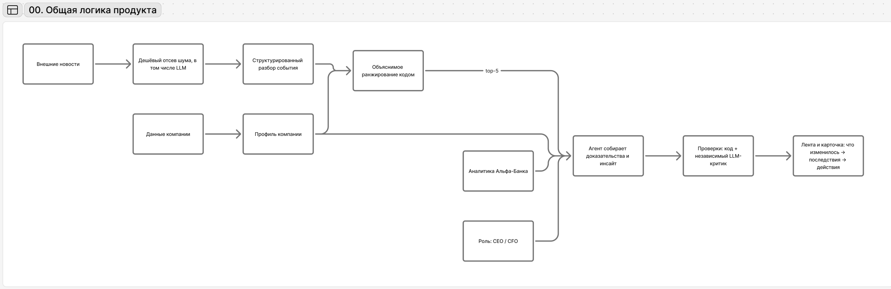

# 00-overview.md — Обзор решения

> **Читать первым.** Этот документ даёт верхнеуровневое представление о продукте, не требуя чтения кода или технического README.

## Что за продукт

Модуль внутри Альфа-Бизнеса, который превращает внешний новостной поток в несколько персональных бизнес-инсайтов для конкретной компании: **что произошло → что это меняет именно для бизнеса → что стоит сделать**.

Продукт не является обычной новостной лентой и не пересказывает статьи. Сначала система дешёво отбирает потенциально важные события, затем кодом сопоставляет их с профилем компании, а генеративная модель используется только для нескольких лучших событий.

## Для кого

Целевая аудитория кейса — лица, принимающие решения в крупном бизнесе. В кейсе крупный бизнес — компания или группа с выручкой свыше 15 млрд ₽; работаем с действующими клиентами Альфа-Банка. В демо основной фокус на двух ролях:

- **CEO** — хочет понять, какое управленческое решение меняет событие;
- **CFO** — хочет понять, какой финансовый показатель, риск или расчёт оно меняет.

Компания определяет, **что важно**. Роль определяет, **как это объяснить и какие действия предложить**. Роль не меняет порядок новостей в ленте.

## Как работает система

1. Новости собираются из внешних источников.
2. Шумные источники проходят дешёвый отсев до полного LLM-разбора.
3. Прошедшая новость один раз превращается в структурированное событие: факты, факторы, отрасли, страны, ссылки.
4. Из банковских данных строится профиль конкретной компании: отрасль, продукты, ВЭД, платежные связи, группа.
5. Код считает объяснимый score для пары **событие × компания** и формирует top-5.
6. Только для top-событий агент собирает дополнительные доказательства, аналитику банка и формирует карточку для нужной роли.
7. Карточка проходит программные проверки и независимого критика.
8. Пользователь получает сначала смысл и действия, а подробные доказательства раскрывает при необходимости.
9. Чат помогает уточнить уже готовый инсайт только в рамках карточки и её доказательств.

Доски схем: [продуктовые схемы](https://www.figma.com/board/WbrIBm9CJqNkLrTFuaI7Gf) (картинки в `docs/diagrams/`) и [технические схемы «Альфа-Хакатон. Схемы»](https://www.figma.com/board/fdJyYxLUrAw5iMqAt9eMPH/?node-id=0-1) — БД, HTTP, Worker, OCR, LLM.

## Основная ценность

Вместо заголовка «ЦБ сохранил ключевую ставку» пользователь должен увидеть вывод уровня:

> Высокая стоимость финансирования сохранится — проверьте долговой и инвестиционный план.
> 

То есть система сокращает путь от **новости** до **решения**.

## Главное доказательство персонализации

Одна и та же внешняя новость должна давать:

- разные позиции в ленте у разных компаний;
- разные причины «Почему я это вижу»;
- разные последствия и действия для разных бизнес-контекстов;
- разные ролевые акценты для CEO и CFO внутри одной компании.

## Что лежит в остальных документах

- `01-product.md` — JTBD, пользовательский сценарий, карточка и UX-гипотезы;
- `02-system-logic.md` — подробная логика отбора, профиля, ranking, агента, проверок и чата;
- `03-evaluation.md` — как измеряем релевантность, TTV, полезность и доверие;
- `04-limitations.md` — ограничения данных, моделей и границы доверия;
- `05-economics-and-scaling.md` — измеренные затраты, модели и расширение решения.

Технический запуск, API, БД, Docker, конфигурация, точные лимиты и endpoints — в [README](../README.md) и технических документах `docs/a02-…`–`docs/d08-…`; замеры расходов и времени — [eval-report.md](eval-report.md).