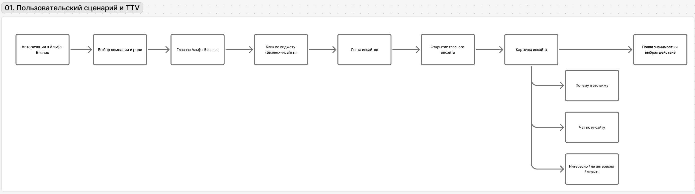
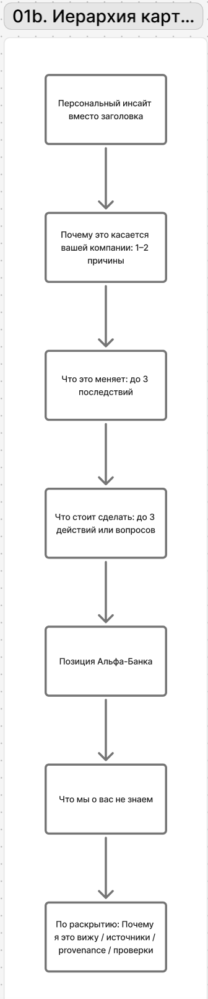

# 01-product.md — Продукт и пользовательские сценарии

## Проблема

Руководителю важна не сама новость, а **как она влияет на его компанию и нужно ли действовать**. Обычная новостная лента заставляет сначала прочитать событие, затем самостоятельно связать его с бизнесом. Мы хотим убрать этот промежуточный анализ.

## JTBD по ролям

**CEO:** когда внешнее событие может изменить условия бизнеса, хочу быстро понять масштаб влияния, риски/возможности и нужен ли управленческий шаг, чтобы не пропустить важное и не тратить время на ручной мониторинг.

В карточке CEO в первую очередь нужны: влияние на бизнес, стратегию, спрос, инвестиции, производство, контрагентов и решение, которое стоит вынести на обсуждение.

**CFO:** когда внешнее событие влияет на стоимость денег, валюту, налоги, цены или расчёты, хочу быстро понять затронутые финансовые показатели и что нужно проверить/пересчитать, чтобы защитить денежный поток, маржу и ликвидность.

В карточке CFO в первую очередь нужны: финансовый механизм влияния, долг, стоимость капитала, cash flow, маржа, ликвидность, валютная позиция и конкретные проверки.

**Принцип:** компания определяет релевантность события; роль меняет интерпретацию и действия, но не ranking.

## Пользовательский сценарий

1. Пользователь входит в Альфа-Бизнес.
2. Выбирает компанию и роль.
3. На главной/в ленте видит до 5 **персональных инсайтов**, а не новостных заголовков.
4. Открывает карточку и за первые 20–30 секунд получает: что произошло → почему важно → последствия → действия.
5. Ниже проверяет позицию Альфа-Банка, причины персонализации, источники и ограничения.
6. При необходимости задаёт уточняющий вопрос в чате или даёт feedback.

### Добавить материал

Для проверки обновляемости системы у жюри есть страница **«Добавить материал»** (доступна всем вошедшим): можно загрузить PDF (до 10 страниц) в контур аналитики Альфа-Банка или отправить ссылку на новость с уже подключённого источника. Ссылка минует только фильтр заголовков, дальше — тот же полный разбор, проверки и ranking; PDF проходит распознавание и индексирование, но считается непроверенным, пока его не сверил оператор. Ручное добавление не гарантирует попадание в ленту.

## Контракт карточки

Система обязана вернуть 6 смыслов:

1. **Что произошло** — короткий подтверждённый факт.
2. **Почему важно именно вам** — связь события с признаками компании.
3. **Последствия** — главные риски/возможности для бизнеса.
4. **Действия** — конкретные следующие проверки, вопросы или решения.
5. **Позиция Альфа-Банка** — только если найдена релевантная аналитика.
6. **Проверки и ограничения** — статус проверок и актуальность данных.

При этом эти 6 блоков **не должны выглядеть равноправными**. Первые четыре отвечают за ценность, последние два — за доверие и проверяемость.

## Иерархия интерфейса

Первый экран карточки:

- персональный вывод вместо исходного заголовка;
- короткая причина «почему это касается вас» (одно предложение до 200 знаков; пока карточки нет, лента показывает короткие метки причин ranking);
- до 3 наиболее важных последствий;
- до 3 действий или вопросов для проверки.

Ниже:

- позиция Альфа-Банка;
- «Что мы о вас не знаем»;
- раскрываемые «Почему я это вижу», источники, provenance и статус проверок;
- кнопка **«Связаться с менеджером»** как явный следующий шаг;
- дисклеймер: **«Ответы ИИ не являются позицией банка и инвестиционной рекомендацией»**.

## Продуктовые гипотезы

Формула: **если мы изменим X для пользователя Y, то метрика Z изменится, потому что изменится конкретный механизм поведения.** Проверяем на одинаковых сценариях и сравниваем с базовой версией карточки.

### H1. Персональный инсайт вместо заголовка

**Если** в ленте показывать персональный бизнес-вывод, а исходный заголовок оставить вторичным, **то TTV снизится, а понимание ценности вырастет**, потому что пользователю не придётся самому переводить новость в контекст компании.

**Метрики:** медианный TTV; доля пользователей, которые за 20–30 секунд правильно отвечают «что изменилось для компании?».

**Проверка:** сравнить «заголовок новости» и «персональный инсайт» на одинаковых событиях.

### H2. Причина персонализации на первом экране

**Если** сразу под инсайтом показать 1–2 причины «почему это касается вас», **то понимание релевантности и воспринимаемая полезность вырастут**, потому что связь события с компанией будет видна без отдельного перехода.

**Метрики:** доля правильных ответов на вопрос «почему это показали этой компании?»; полезность по feedback.

**Проверка:** карточка с краткой причиной против версии, где причины доступны только по раскрытию.

### H3. Последствия раньше подробностей

**Если** после короткого факта сразу показать до трёх последствий для бизнеса, **то TTV до понимания влияния снизится**, потому что пользователь быстрее получит ответ на главный вопрос — «что это меняет для меня?».

**Метрики:** время до правильного ответа о последствиях; доля пользователей, которые за 20–30 секунд называют хотя бы одно корректное последствие.

**Проверка:** сравнить порядок «факт → подробности → последствия» с «факт → последствия → подробности».

### H4. Действия сразу после последствий

**Если** сразу после последствий показать 2–3 конкретных действия или вопроса для проверки, **то доля инсайтов с осмысленным следующим шагом вырастет**, потому что пользователю не придётся самостоятельно переводить анализ в действие.

**Метрики:** TTV; доля осмысленных следующих шагов; вопрос в чате; положительный feedback; `source_opened`, `action_interacted`, `manager_contact_requested`.

**Проверка:** карточка с действиями против карточки только с анализом; отдельно проверить, может ли пользователь сам назвать следующий шаг.

### H5. Доказательства на втором уровне

**Если** позицию банка, подробный provenance, причины ranking и источники показывать по раскрытию после основного вывода, **то TTV снизится без потери доверия**, потому что быстрый сценарий станет короче, а проверяемость останется доступной.

**Метрики:** TTV; открытия источников и доказательств; оценка доверия/полезности.

**Проверка:** сравнить плоскую карточку со всеми блоками и карточку с постепенным раскрытием.

### H6. Не более трёх последствий и действий

**Если** показывать только до трёх наиболее значимых последствий и действий, **то скорость понимания и запоминаемость главного вывода вырастут**, потому что пользователь не будет самостоятельно выбирать главное из длинного текста модели.

**Метрики:** TTV; доля пользователей, которые после просмотра воспроизводят главный вывод и следующий шаг.

**Проверка:** короткая карточка против версии с 5+ пунктами.

### H7. Одна структура карточки, ролевой акцент внутри

**Если** CEO и CFO использовать одну структуру карточки, но менять последствия, действия и акценты под роль, **то полезность для каждой роли вырастет без роста когнитивной сложности интерфейса**, потому что навигация останется знакомой, а смысл будет отвечать задаче роли.

**Метрики:** полезность по роли; TTV CEO/CFO; доля правильных ответов «какое решение это меняет?» для CEO и «что нужно проверить/пересчитать?» для CFO.

**Проверка:** одно событие показать обеим ролям и сравнить воспринимаемую полезность при одинаковой структуре.

## Метрики продукта

**North Star Metric — TTV (Time to Value):** время от первого показа персонального инсайта до момента, когда пользователь понял его ценность для бизнеса.

В пользовательском тесте запускаем таймер при первом показе инсайта и останавливаем его, когда пользователь считает, что понял смысл. Затем проверяем понимание тремя вопросами: **что произошло → почему это важно компании → что делать дальше**. Если ответ неполный, таймер продолжается до корректного понимания. Основной показатель — **медианный TTV**; дополнительно смотрим долю пользователей, достигших ценности за ≤30 секунд и долю не достигших её в рамках теста.

Осмысленные следующие шаги остаются supporting-метрикой: открытие источника, вопрос в чате, взаимодействие с действием, запрос связи с менеджером или положительный feedback. Для воронки уже логируются `insight_opened`, `reasons_opened`, `source_opened`, `action_interacted` и `manager_contact_requested`.

**Понимание ценности:** доля пользователей, которые после короткого просмотра правильно воспроизводят событие, персональную причину и хотя бы один следующий шаг.

**Релевантность top-5:** доля событий в верхней части ленты, которые ручной эксперт считает действительно важными для выбранной компании. Эта метрика проверяет ядро персонализации отдельно от качества текста карточки.

**Полезность:** доля положительных оценок среди сигналов, по которым пользователь дал feedback; на пилоте отдельно анализируем причины отрицательной оценки.

**Доверие и проверяемость:** доля опубликованных утверждений с корректным происхождением и доступным доказательством; отдельно считаются ошибки проверок и случаи «позиция банка не найдена».

**Воронка ценности:** показ инсайта → открытие карточки → осмысленный следующий шаг. Она помогает отличить проблему ranking от проблемы интерфейса или содержания карточки.

Численные targets задаём после первого пользовательского прогона и baseline. До этого показываем реальные измерения и направление эффекта каждой гипотезы.

## Демо

Основное доказательство — одно событие на двух контрастных компаниях. Пользователь должен увидеть не просто разные тексты, а **разную причинно-следственную связь и разные действия**. Затем внутри одной компании переключаем CEO/CFO и показываем, что ranking тот же, но смысл и действия адаптируются под роль.