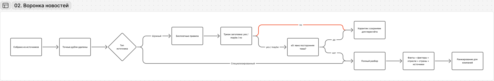
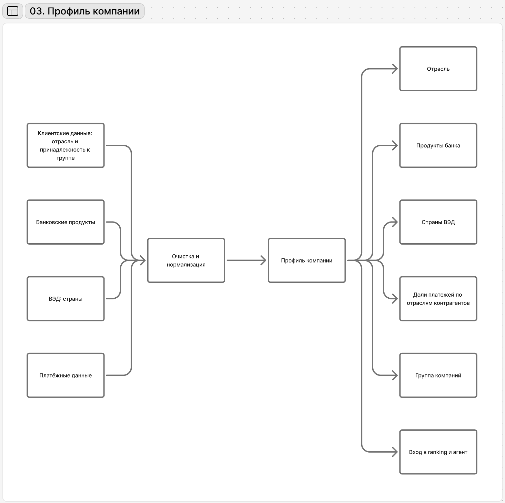
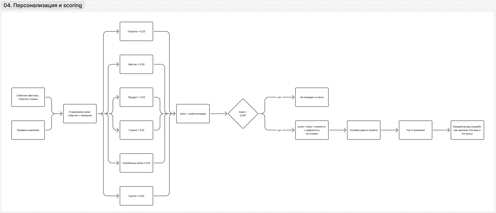
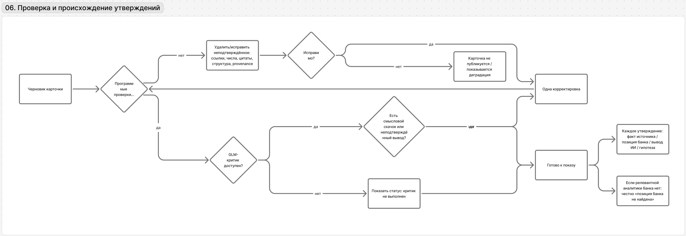
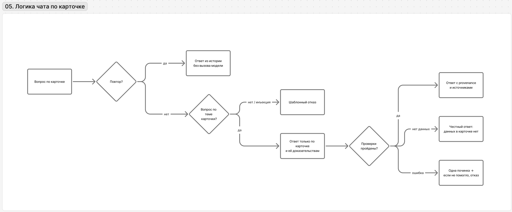

# 02-system-logic.md — Логика системы

> Этот документ описывает **логику системы** на уровне, достаточном для продуктовой и архитектурной проверки. Точные классы, endpoints, retries, конфиги и лимиты — в [README](../README.md) и технических документах `docs/a*`, `docs/d*`.

## 1. Отсев и разбор новостей

**Задача механизма:** не тратить дорогой полный анализ на весь внешний поток.

Источники разделяются на два контура:

- **специализированные** — могут сразу идти на полный разбор;
- **общие/шумные** — сначала проходят дешёвый отсев.

Для шумного потока последовательность такая:

1. простые правила удаляют очевидный технический мусор и точные дубли;
2. DeepSeek-V4.1-Flash без рассуждений (самый дешёвый режим) получает пакет до 50 записей `id + заголовок` и ставит `yes / maybe / no`;
3. `yes` и `maybe` проходят дополнительную e5-проверку на явно постороннюю тему;
4. только после этого запускается полный разбор статьи;
5. `no` и отсеянные записи не удаляются — остаются в базе со статусом `rejected` и причиной отказа. Автоматического пересмотра нет; если ту же ссылку добавить вручную, новость возвращается в полный разбор.

Логика классов:

- `yes` — конкретное событие с явным деловым эффектом;
- `maybe` — деловой канал есть, но масштаб/последствия по заголовку неясны;
- `no` — значимость появляется только если её додумывать.

На полном разборе новость один раз превращается в структурированное событие: **факты, факторы, отрасли, страны, участники и ссылки на источники**. Эти данные потом переиспользуются для всех компаний.

**Деградация:** ошибка раннего фильтра не должна быть необратимой. Поэтому rejected-записи хранятся; если сбор или источник временно недоступны, лента продолжает работать на последнем снимке, а интерфейс показывает время последнего успешного сбора и признак сбоя сбора.

### Добавление материала

Страница **«Добавить материал»** подключает ручной вход в уже существующие контуры: PDF (до 10 страниц и 50 МБ) проходит распознавание и индексируется как материал банка со статусом «не сверен» — пока оператор не сверит страницы, карточка отмечает это в ограничениях. Ссылка на новость принимается только с хоста включённого источника (allowlist не обходится); она минует фильтр заголовков и e5, но проходит полный разбор, программные проверки и ranking. Ручное добавление не гарантирует попадание в ленту.

## 2. Профиль компании

**Задача:** дать событию контекст конкретного бизнеса до генеративной интерпретации.

Профиль формируется кодом из доступных банковских данных и включает:

- отрасль компании;
- банковские продукты;
- страны ВЭД;
- доли платёжного оборота по отраслям контрагентов;
- принадлежность к группе компаний.

Перед использованием данные очищаются и нормализуются: технические дубли, некорректные значения и внутренние особенности датасета не должны попадать в персонализацию как бизнес-факты. Точные правила очистки фиксируются разработчиком рядом с импортом данных.

**Важно:** группа — дополнительный контекст, но единица ленты остаётся отдельной компанией. Платёжные данные показывают факт связи, но не позволяют автоматически называть контрагента «поставщиком» или «покупателем».

## 3. Ранжирование и ядро персонализации

**Задача:** выбрать несколько событий, действительно связанных с конкретной компанией, до запуска дорогого агента.

Для каждой пары **событие × компания** код считает 6 признаков:

- отрасль — вес **0,25**;
- чувствительность отрасли к фактору — **0,30**;
- банковский продукт ↔ фактор — **0,15**;
- страна ВЭД — **0,10**;
- платёжные связи — **0,15**;
- связь через группу — **0,05**.

`base` — сумма этих вкладов. Итоговый `score = 2^(−возраст в днях / 7) × надёжность источника × base`. В ленту допускаются события с `base ≥ 0,30`, `score ≥ 0,15`, опубликованные за последние **7 дней** (с 00:00 МСК шестого предыдущего дня). У события-комментария (заявление, интервью, ожидание без нового решения или данных) вклад чувствительности отрасли берётся с половинным весом. Уровни значимости задаются порогами **0,40** и **0,50**. После склейки одного сюжета в одно место пользователю показывается до **5 лучших событий**.

Каждый ненулевой вклад сохраняется как объяснение для «Почему я это вижу». Поэтому ranking одновременно решает две задачи: **выбор** и **объяснимость**.

**Важно:** роль пользователя и наличие аналитики Альфа-Банка не влияют на score. Ranking одинаков для CEO/CFO; роль вступает в работу позже.

Матрица `отрасль × фактор` и правила `продукт → фактор` лежат в данных (`data/taxonomy.json`, загружается при старте Worker), а не зашиты в алгоритм. Подробности и калибровка — [a10-ranking.md](a10-ranking.md), [calibration-thresholds.md](calibration-thresholds.md).

## 4. Агент

**Задача:** не решать, какая новость важна, а превратить уже отобранное событие в доказательный бизнес-инсайт.

На вход агент получает:

- событие;
- компанию;
- роль пользователя;
- причины, по которым событие прошло ranking.

Дальше агент:

1. определяет, каких данных не хватает для вывода;
2. читает только разрешённые read-only инструменты: профиль компании, платежи/группу, матрицу чувствительности, источники, похожие события, материалы Альфа-Банка;
3. собирает доказательства в реестр `E*`;
4. формирует карточку из обязательных смысловых блоков;
5. отправляет результат на проверки;
6. при замечании делает ограниченную корректировку.

Модель не должна ссылаться на факты, которых нет в полученных доказательствах. Если данных не хватает, это отражается как ограничение, а не восполняется фантазией.

Для агента используется **DeepSeek-V4.1-Flash**: в предварительном тесте новостей он дал 4 полностью корректных результата из 5 и 100% дословных цитат. Обратную схему с GLM в роли агента проверяли отдельно (прогоны 25.10, `contracts/mock-runs/`), но не приняли: GLM чаще ошибался в ссылках на конкретные утверждения и evidence-фрагменты, что ухудшало трассируемость. Шаги агента, вызовы инструментов и вердикт критика сохраняются (`agent_run`, `agent_step`, `llm_usage`); этапы со статусом и длительностью отдаёт `GET /api/insights/{id}/steps`. Подробности — [a11-agent.md](a11-agent.md).

## 5. Проверки и происхождение утверждений

**Задача:** не позволить уверенно показывать неподтверждённые выводы.

Проверка идёт в два слоя:

1. **код** проверяет структуру карточки, ссылки, числа, цитаты и корректность provenance;
2. **независимый GLM-критик** ищет смысловые скачки и выводы, которые не следуют из доказательств. GLM также выбран для OCR: на тесте PDF дал допустимый ответ на 3/3 страниц и совпадение 40/40 заранее выбранных контрольных значений, поэтому используем его там, где он показал лучший профиль качества/стоимости.

Если отдельное утверждение не проходит программную проверку, оно удаляется из карточки (если так удаляется последнее действие — это ошибка карточки). Одна попытка починки запускается только для ошибок карточки целиком или по замечаниям независимого критика. Утверждение из замечаний критика, которое починка не исправила, получает статус «не подтверждено» и уходит из действий. Если критик не отработал (выключен, нет бюджета, ошибка), карточка показывает это в статусе проверки. Карточка, не прошедшая проверки и после починки, получает статус «не удалось» с кнопкой «Повторить» (до трёх попыток).

4 типа происхождения:

- **факт из источника**;
- **позиция Альфа-Банка**;
- **вывод ИИ**;
- **гипотеза**.

В интерфейсе факты из профиля и платёжных данных дополнительно помечаются как **«Данные компании»** — это источник факта о клиенте, а не отдельный тип модельного вывода.

Для позиции банка действует правило актуальности: обзор не старше **60 дней** может использоваться как текущая позиция по теме; материал **60–120 дней** — только как «оценка банка на дату» и только при отсутствии более свежего обзора; материалы старше **120 дней** или без даты не используются как позиция банка. Если подходящий материал не найден, показывается «позиция банка не найдена» — вывод модели не выдаётся за позицию банка.

## 6. Почему эта архитектура агентная, но не multi-agent

Agentic-поведение находится там, где оно действительно нужно: модель сама определяет, какие read-only данные запросить, собирает доказательства, проверяет полноту и при необходимости корректирует результат.

Отдельные агенты для ranking, сбора новостей или каждого источника не нужны: эти задачи дешевле, предсказуемее и объяснимее решаются кодом и специализированными шагами. Это уменьшает стоимость и количество точек отказа.

## 7. Чат по инсайту

**Задача:** помочь разобраться в уже готовой карточке, не запускать новый анализ.

- повторный вопрос берётся из истории без нового вызова модели;
- новый вопрос сначала проверяется на связь с карточкой и попытку обойти правила;
- ответ строится только по карточке и её доказательствам — без нового поиска, инструментов и данных других клиентов;
- код проверяет ссылки, числа и происхождение утверждений; ошибочное утверждение код убирает, одна починка — только если не проходит сам связный ответ; при нехватке данных система честно говорит об этом;
- роль CEO/CFO меняет акцент ответа, но не факты.

Лимиты: вопрос до 1000 символов, до 10 вопросов на карточку, сбой не расходует лимит. Подробности и живой прогон — [a13-chat.md](a13-chat.md).

