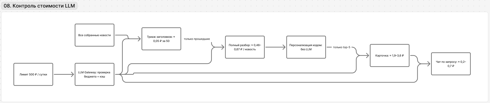

# 05-economics-and-scaling.md — Экономика и масштабирование

## Принцип экономики решения

Ограничение кейса — **500 ₽ на LLM в сутки**, но нашей целью не было сделать систему максимально дешёвой. Мы искали **компромисс между стоимостью и качеством доставки ценности**.

Основной принцип: **экономить там, где задача решается дешёво и детерминированно, и тратить модельный бюджет там, где он действительно улучшает пользовательский результат**.

Поэтому мы не запускаем сильную модель на каждом заголовке и для каждой компании. Но и не экономим на финальной интерпретации и проверке тех событий, которые уже доказали свою релевантность.

## Где экономим, а где платим за качество

| Этап | Решение | Почему |
| --- | --- | --- |
| Массовый поток заголовков | дешёвый triage + e5 | здесь важнее быстро убрать очевидный шум |
| Полный разбор новости | LLM один раз на событие | результат переиспользуется для всех компаний |
| Персонализация | формула и справочники в коде | дешевле, объяснимее и стабильнее LLM-ranking |
| Top-события | агентный анализ | здесь появляется основная пользовательская ценность |
| Проверка карточки | код + независимый критик | на доверии и корректности сознательно не экономим |
| Повторные результаты | кэш | одинаковый результат не генерируем заново |
| Чат | только по действию пользователя | дополнительные расходы возникают только при дополнительной ценности |

Таким образом, стоимость растёт не вместе со всем входным новостным потоком, а в основном вместе с количеством **действительно релевантных карточек и запросов пользователя**.

## Реальные замеры 25.10

Экономика ниже основана на фактических записях основной базы `alfanews`. Для текущей карточки используем окно **CUR** — карточки после 24.10 14:40 UTC. Полная история **ALL** содержит ранние эксперименты, разные версии промптов и больше технических сбоев, поэтому не используем её как текущую себестоимость.

**Карточка инсайта, CUR:**

- 27 готовых карточек;
- средняя известная стоимость готовой карточки — **1,71 ₽**;
- медиана — **1,60 ₽**, p90 — **2,43 ₽**;
- если учитывать два платных прогона, которые после работы завершились ошибкой, — **1,81 ₽ на готовую карточку**;
- CEO — 1,73 ₽ в среднем, CFO — 1,68 ₽.

По стадиям текущего окна: план ≈ **0,20 ₽** за запрос, черновик ≈ **0,70 ₽**, критик ≈ **0,10 ₽**, починка ≈ **0,54 ₽**. Починка понадобилась 18 из 27 готовых карточек; на черновик и repair приходится около 70% стоимости карточки. Это главный видимый резерв дальнейшей оптимизации.

**Другие стадии по всей базе:**

- triage заголовков — около **0,058 ₽ за пакет** (до 50 заголовков);
- полный разбор новости — около **0,41 ₽ на принятое событие** с учётом повторов после `invalid_output`;
- 14 платных OCR-вызовов — 3,36 ₽ суммарно;
- 8 платных chat-вызовов — 1,57 ₽ суммарно;
- 12 `scope_gate` — 0,55 ₽ суммарно.

Известные расходы всей базы — **203,18 ₽**. Резервы по `request_abandoned` на 62,39 ₽ вынесены отдельно и не считаются фактическим расходом.

Это измерения прототипа, а не production-тариф: база содержит несколько версий промптов и ограниченную конкурентность. Полный отчёт, исходные строки и скрипт пересчёта — [eval-report.md](eval-report.md) и `docs/eval/`.

### Время обработки

В текущем окне карточка от создания до `ready` занимала **p50 132 с**, p90 — **207 с**. Для short feed путь «приём публикации → структурированное событие» без простоя воркера: p50 **108 с**, p90 **283 с**.

При этом сама работа `ParseNews` занимала медианно **23 с**, а ожидание в очереди — **106 с**. Значит, следующий резерв ускорения — не только модель, но и очередь/конкурентность воркеров.

Это **не SLA и не продуктовый TTV**: TTV измеряет, как быстро пользователь понимает ценность уже показанного инсайта.

## Модель стоимости при росте

У системы есть четыре разных типа затрат:

1. **Общие для всех клиентов.** Сбор новости, triage и полный разбор события происходят один раз независимо от числа компаний.
2. **Дешёвые персональные.** Для каждой пары `событие × компания` код считает score без LLM.
3. **Дорогие персональные.** Агент и критик запускаются только для событий, попавших в верх ленты конкретной компании.
4. **Пользовательские.** Чат создаёт затраты только после явного вопроса пользователя.

Это важно для масштабирования: рост числа клиентов **не должен линейно умножать стоимость полного анализа всего новостного потока**. Повторно растёт прежде всего дешёвый scoring и число реально востребованных персональных карточек.

## Выбор моделей: качество там, где оно важно

Используем две модели и распределяем задачи по результатам собственного теста, а не по принципу «одна модель на всё».

- **DeepSeek-V4.1-Flash** — triage, разбор новости, агент, карточка, чат и проверка тематики вопроса. На тесте новостей DeepSeek дал 4 полностью корректных результата из 5 и 100% дословных цитат; для агента важна также точность ссылок на конкретные доказательства.
- **GLM-5.3-Flash** — OCR банковской аналитики и независимый критик. На тесте PDF GLM дал допустимый ответ на 3/3 страниц и совпадение 40/40 заранее выбранных контрольных значений при существенно меньшей стоимости, чем DeepSeek на PDF.

Мы отдельно проверили обратную схему — агент на GLM, критик на DeepSeek. Она дала более строгого критика, но GLM-агент чаще ссылался не на тот evidence-фрагмент. Для банковского сценария неверная трассировка опаснее, поэтому оставили **DeepSeek как генератор доказательного инсайта, GLM как независимую проверку**.

Выборка теста небольшая, поэтому это обоснование MVP, а не универсальный рейтинг моделей.

## Как контролируется бюджет

Общий лимит ключа — **500 ₽ в сутки**. Его делят новости, карточки, OCR и чат, поэтому задача архитектуры — не «поместить как можно больше LLM-вызовов», а не тратить дорогие вызовы до появления доказанной релевантности.

По фактической стоимости **1,81 ₽ на готовую карточку с учётом платных неуспешных прогонов**:

| Готовых карточек | Оценка стоимости |
| --- | --- |
| 50 | ≈ 91 ₽ |
| 100 | ≈ 181 ₽ |
| 200 | ≈ 362 ₽ |

Это только карточки: из тех же 500 ₽ оплачиваются разбор новостей и чат. Поэтому таблица показывает запас по порядку величины, а не допустимое число карточек в production.

Перед модельными вызовами система резервирует оценку стоимости и сверяет её с дневным лимитом стенда (`LLM_DAILY_LIMIT_RUB`) и с расходом общего ключа на шлюзе; готовые результаты кэшируются. При исчерпании бюджета новые LLM-вызовы прекращаются; если из-за лимита не выполнен критик, это отражается в статусе. Отдельной приоритизации типов вызовов внутри бюджета сейчас нет.

# Масштабирование

Масштабирование разделяем на **масштаб клиентов**, **масштаб предметной области** и **масштаб источников/контента**. Они требуют разных изменений.

## 1. Больше компаний

Для новой компании не создаётся отдельный агент и не разбираются новости заново.

Если доступны стандартные признаки профиля — отрасль, продукты, ВЭД, платежные связи и группа — система:

1. строит профиль компании;
2. применяет к уже разобранным событиям ту же scoring-формулу;
3. запускает агент только для её top-событий.

**Что растёт:** количество дешёвых вычислений score и число карточек для действительно релевантных событий.

**Что не растёт пропорционально клиентам:** сбор новостей, triage, полный разбор новости и OCR банковских материалов — эти результаты общие.

При большом количестве компаний следующий шаг оптимизации — считать score пакетно и ограничивать генерацию карточек только активными клиентами/событиями выше более строгого порога.

## 2. Новая отрасль

Алгоритм ranking менять не нужно, но качество новой отрасли требует предметной настройки.

Для подключения отрасли нужно:

1. определить основные внешние факторы, которые на неё влияют;
2. добавить строки в матрицу `отрасль × фактор` и веса чувствительности (`data/taxonomy.json`, код не меняется);
3. проверить связанные продуктовые правила;
4. прогнать набор реальных новостей и вручную проверить top-5 на компаниях этой отрасли;
5. откалибровать матрицу по ложным попаданиям и пропускам.

То есть новая отрасль подключается **через данные и валидацию**, а не через переписывание pipeline.

## 3. Новый банковский продукт

Для нового продукта добавляется связь `продукт → фактор` и смысл канала влияния.

Например, продукт должен не просто совпасть с тегом новости, а объяснять, **почему событие меняет финансовую или операционную ситуацию клиента**. После добавления правила оно проверяется на выборке событий, чтобы один широкий продуктовый сигнал не начал протаскивать нерелевантные новости.

## 4. Новая пользовательская роль

Ranking остаётся прежним: одна компания должна видеть одни и те же важные события независимо от должности.

Для новой роли требуется:

1. определить её JTBD;
2. зафиксировать приоритетные последствия, показатели и действия;
3. изменить ролевые промпты и контракт генерации карточки/чата;
4. проверить на одинаковом наборе событий, что факты сохраняются, а меняется именно перспектива и рекомендации.

То есть новая роль не требует нового ranking, но в текущей реализации является **изменением кода/промптов**, а не простой строкой конфигурации.

## 5. Новый новостной источник

Перед подключением источник классифицируется как **специализированный** или **шумный**.

Для него нужно:

1. проверить стабильность и права использования;
2. задать коэффициент надёжности;
3. добавить запись в каталог `data/sources.json` (шумный) или `data/sources-specialized.json` (специализированный): RSS, разрешённые хосты, интервал, надёжность — сбор и дедупликация работают без изменения кода;
4. для шумного источника — проверить triage на реальных заголовках;
5. посмотреть, увеличил ли источник число полезных событий или только стоимость и шум.

Источник остаётся в контуре только если даёт дополнительное покрытие значимых событий.

## 6. Больше аналитики Альфа-Банка

Новый документ банка обрабатывается один раз: OCR/извлечение → дата и источник → разбиение на фрагменты → индекс.

После этого агент может находить его для любых компаний и событий. Стоимость первичной обработки документа общая, а не клиентская.

При росте базы основной контроль качества — актуальность, корректность извлечённых чисел и возможность однозначно отличить **позицию банка** от вывода модели.

## 7. Рост новостного потока

Это наиболее чувствительный контур по стоимости.

Масштабируем его ступенчато:

**правила/дедупликация → дешёвый triage → e5 → полный разбор → company scoring → top → агент**.

Если поток растёт, первым масштабируется именно дешёвый слой отбора. Дорогой полный анализ не должен расти с той же скоростью, что количество входных публикаций.

## Что требует ручной работы при масштабировании

Архитектура конфигурируема, но качество не возникает автоматически. Ручная или экспертная работа остаётся в четырёх местах:

- калибровка `отрасль × фактор` для новых отраслей;
- проверка правил `продукт → фактор`;
- оценка качества и надёжности новых источников;
- JTBD и критерии полезности для новых ролей.

После накопления обратной связи часть этих настроек можно калибровать данными, но в текущем MVP это контролируемая экспертная конфигурация.

# Бизнес-экономика

На хакатоне мы можем доказать **стоимость и эффективность AI-конвейера**, но не денежный эффект для банка.

Следующий этап — пилот, где проверяется цепочка:

**релевантный инсайт → быстрое понимание → осмысленный следующий шаг → повторное использование → доверие/лояльность**.

Только после этого можно связывать продукт с retention, глубиной отношений с банком или финансовым эффектом. До пилота такие значения остаются гипотезами.