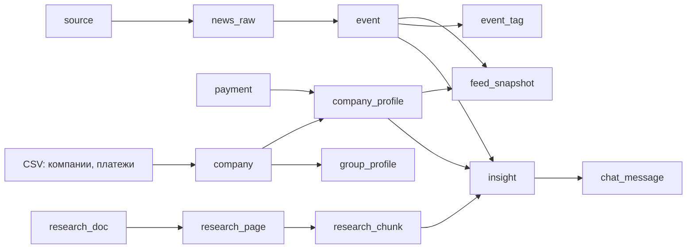

# Модель данных

Источник правды: [contracts/database.sql](../contracts/database.sql) и [contracts/database.md](../contracts/database.md). Схема применяется EF-миграцией ([InitialSchema](../backend/AlfaNews.Core/Data/Migrations)). Все JSON-поля соответствуют типам из [backend/AlfaNews.Contracts](../backend/AlfaNews.Contracts). Идентификаторы UUID создаёт приложение, время хранится в UTC.

## Как данные идут по конвейеру

Worker заполняет всё, что слева от `feed_snapshot` и `insight`; API читает готовое и ставит задания в `background_job`.

## Группы таблиц

### Компании и профили
- **company** — только `CLIENT`. Частые поля вынесены в колонки (`group_id`, ОКВЭД, регион, выручка), 24 исходные колонки лежат в `raw_data`. Выручка 1000 из CSV — заглушка и хранится как `null`.
- **payment** — ребро `payer → beneficiary` с суммой и числом платежей. Внешних ключей на `company` нет: часть участников не имеет CLIENT-профиля, но их платежи нужны в знаменателе оборота.
- **company_profile / group_profile** — посчитанные кодом и SQL признаки (`profile_json`): продукты, страны ФТС, платёжные доли, состав группы.
- **factor, sector_sensitivity, product_factor_rule** — таксономия факторов и проверенные вручную правила чувствительности. Матрица заполнена только для двух демо-отраслей.

### Доступ
- **app_user** — логин, bcrypt-хэш, признак оператора и активности.
- **auth_session** — SHA-256 токена, срок, отзыв. Каждый запрос проверяет срок, отзыв и активность.
- **user_company_access** — доступ `пользователь × компания × роль (ceo/cfo)`. На него опираются API и инструменты агента: `company_id` никогда не приходит от LLM.

### Новости
- **source** — конфигурация источника (RSS, allowlist хостов, надёжность, статус проверки).
- **news_raw** — исходный текст и URL, статус обработки; `canonical_url` уникален, `text_sha256` ловит явные дубли.
- **event** — результат разбора новости (`extraction_json`), полнотекстовый `search_text` и вектор `embedding(768)`. Один `content_sha256` — один LLM-разбор.
- **event_source** — ссылки события на каноническую новость и явные дубли. **event_tag** — теги (фактор, ОКВЭД, страна, регион, товар) для отбора.

### Аналитика банка (PDF)
- **research_doc → research_page → research_chunk**: документ, страницы с PNG и результатом OCR, смысловые блоки (`fact`, `bank_view`, `forecast`, `disclaimer`) с таблицами и графиками. У каждого уровня свой `review_status` (ручная сверка); итог страницы и документа агрегирует сервер.

### Лента, карточки, чат
- **feed_snapshot** — последний порядок событий компании (`items_json`). Роль в ключе отсутствует: лента у CEO и CFO общая.
- **insight** — версия полной карточки по `company × event × role × input_version`; `body_json` заполнен только при `ready`. Старая версия не выдаётся как новая после смены данных или сверки OCR.
- **chat_message** — один вопрос и ответ; история строго `пользователь × карточка`.
- **feedback** — последняя оценка пользователя для `company × event`; `hide` скрывает событие только этому пользователю.
- **user_activity** — минимальный журнал действий в интерфейсе; пользователя, компанию и время задаёт сервер.

### Фон, агент, расходы
- **background_job** — единая очередь заданий (kind, payload, приоритет, попытки, результат).
- **agent_run / agent_step** — журнал прогонов и шагов агента без скрытых рассуждений.
- **llm_usage** — токены, модель, стоимость и время каждого вызова; `actual_cost_rub = null` означает «провайдер не сообщил», а не ноль. **llm_cache** — кэш валидированных ответов.

## Что не выходит наружу
`password_hash`, `token_hash`, серверные пути файлов, промпты и ключи не попадают в API. Страница PDF отдаётся через разрешённый endpoint, а не по пути на диске.

## Ограничения, которые SQL не выражает
Ссылки `refs`, числа, `origin` утверждений, сверку и права доступа проверяет приложение. Наличие `body_json` само по себе не означает готовую карточку: смотрите `status = ready`.